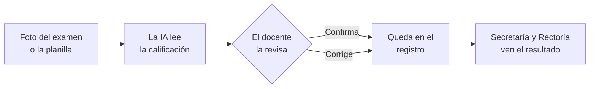
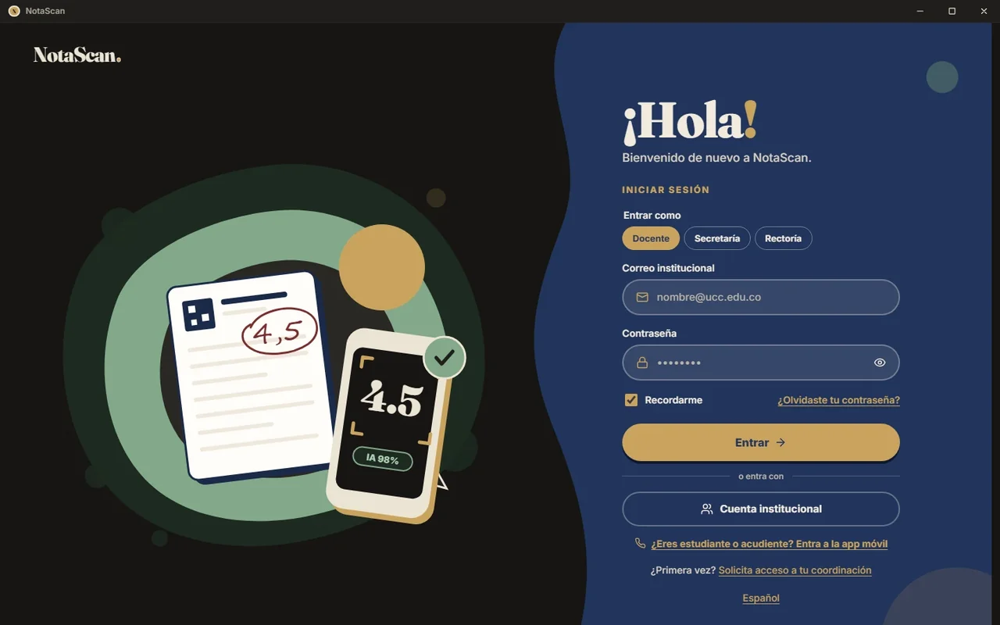
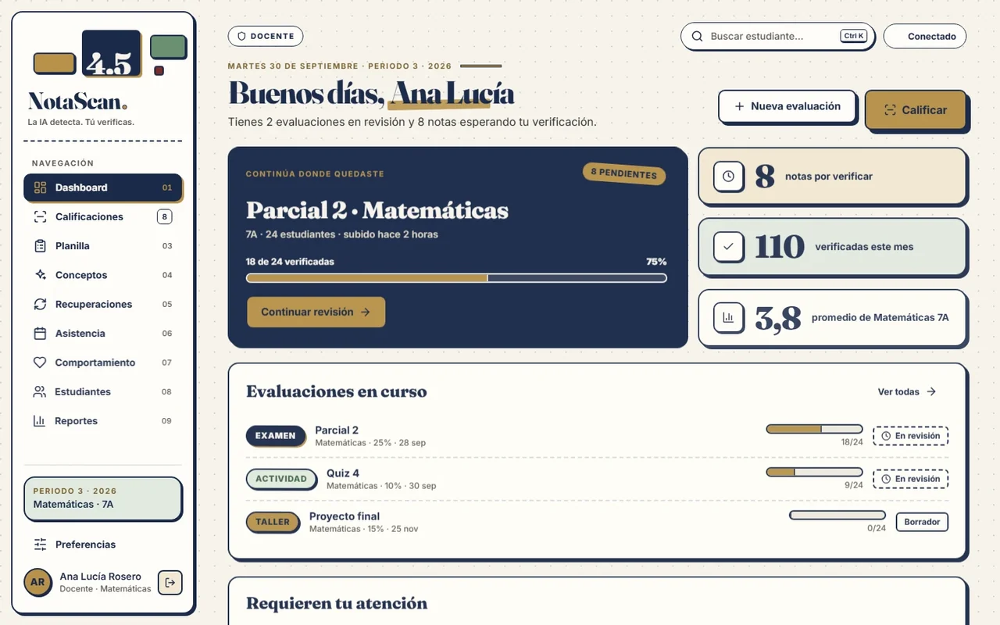
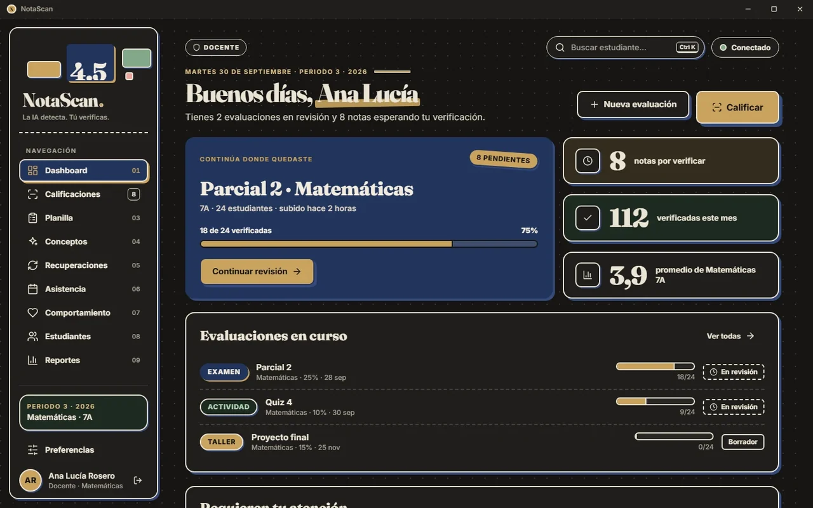
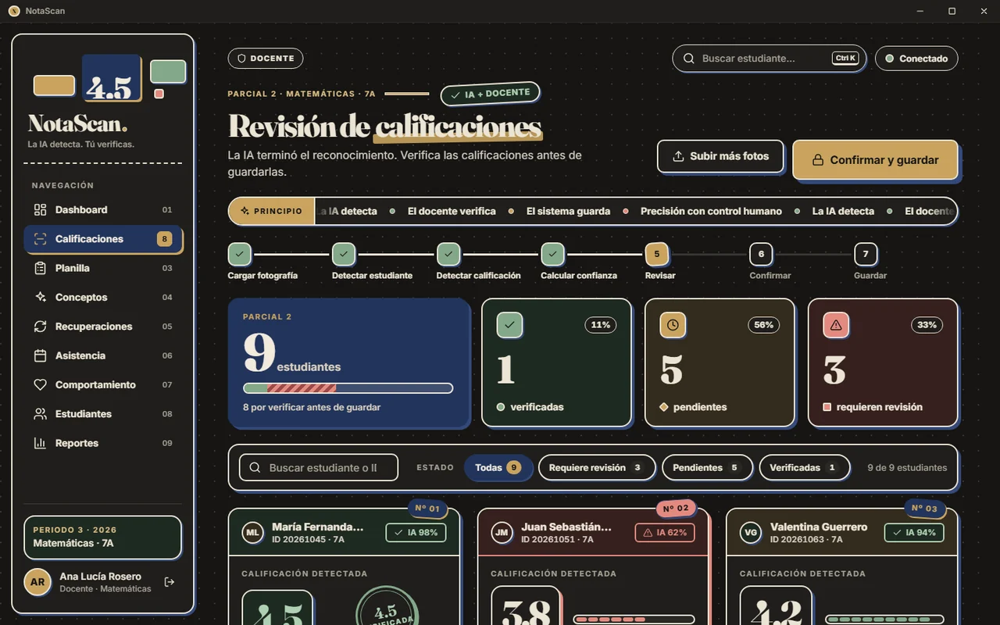
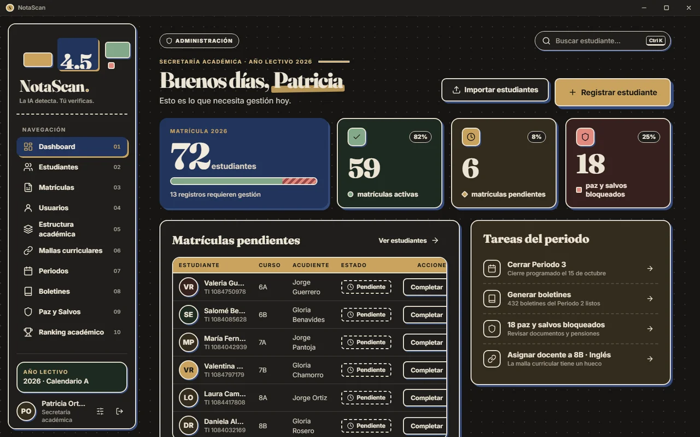
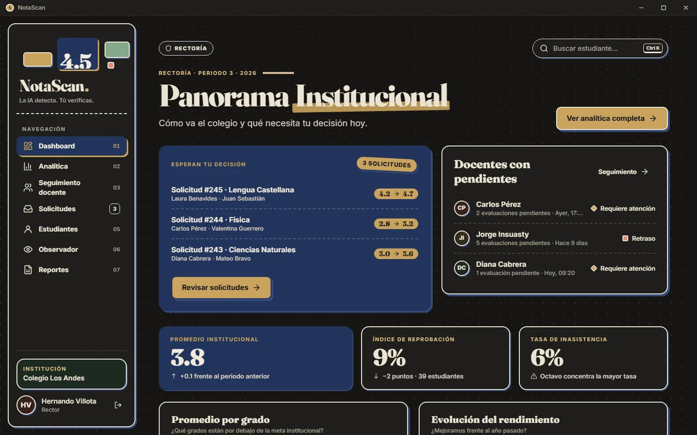

<div align="center">


# NotaScan

**La IA lee la nota. El docente la verifica. El sistema la guarda.**

App de escritorio para colegios que pasa a limpio las notas escritas a mano<br/>
sin quitarle al docente la última palabra.


[Descargar](https://github.com/diarpicu2022-commits/notascan-escritorio/releases) · [Cómo probarla](#cómo-probarla) · [Cuentas de prueba](https://github.com/diarpicu2022-commits/mi-portafolio/blob/feat/portfolio-foundation/docs/Cuentas%20de%20prueba.md) · [Portafolio](https://mi-portafolio-beta-kohl.vercel.app)

</div>

---

## La idea

En muchos colegios la nota se escribe dos veces. Primero en el examen o en la planilla de papel y después, a mano otra vez, en el sistema. En esa segunda digitación se cuelan los errores y se va la tarde del docente. NotaScan quita ese paso, pero nada entra al registro sin que una persona lo confirme.



## Capturas

<div align="center">

| Ingreso | Panel del docente (claro) | Panel del docente (oscuro) |
|:---:|:---:|:---:|
|  |  |  |
| **Revisión de calificaciones** | **Secretaría** | **Rectoría** |
|  |  |  |

</div>

## Qué hace

### Un espacio para cada rol

| Rol | Qué hace |
|---|---|
| **Docente** | Revisa las notas que leyó la IA, lleva la planilla, la asistencia, el observador, los conceptos y las recuperaciones |
| **Secretaría** | Matrícula una por una o importando CSV o Excel, estructura del colegio, malla, periodos, usuarios y paz y salvo |
| **Rectoría** | Ve el rendimiento del colegio y de cada docente, atiende las solicitudes (como los cambios de nota) y consulta el observador |
| **Plataforma** | Da de alta los colegios que usan el servicio y ve su uso, sin ver datos de estudiantes |

### Revisión con la persona al mando

- Cada nota leída llega como tarjeta con su confianza. El docente la confirma, la corrige o la deja pendiente.
- Las notas que la IA no leyó con seguridad se marcan aparte para que no pasen sin mirar.
- Un cambio de nota después de cerrado el periodo pasa por Rectoría.
- Las fotos se pueden subir desde el celular, sin pasarlas al computador.

### Hecho para el aula colombiana

- Escala de 1,0 a 5,0, periodos, malla curricular, observador y paz y salvo, como se trabaja en los colegios de aquí.
- Matrícula masiva desde CSV o Excel, que entra completa o no entra (nunca a medias).

### Cómoda de usar

- **Modo claro y modo oscuro** «Campo marino», y la opción de seguir al sistema.
- **Español, inglés y portugués**, con fechas y números en el formato de cada idioma.
- Ventana propia con su barra de título, en Windows, Linux y macOS.
- Cada pantalla tiene su vista de cargando, vacío, error y sin permiso.

## Cómo probarla

### Opción 1 · Modo demo, sin cuenta

Usa datos simulados de un colegio de ejemplo y deja pasar por los tres roles.

```bash
cd notascan-desktop
npm install
npm run build:demo
npm run preview        # abre http://localhost:4173
```

### Opción 2 · Con cuenta

1. Descarga el instalador desde [**Releases**](https://github.com/diarpicu2022-commits/notascan-escritorio/releases) (Windows) o desde el último flujo `notascan-multiplataforma` en la pestaña **Actions** (Windows, Linux y macOS).
2. Instálalo y ábrelo.
3. Entra con una de las [cuentas de prueba](https://github.com/diarpicu2022-commits/mi-portafolio/blob/feat/portfolio-foundation/docs/Cuentas%20de%20prueba.md). Cada una abre un rol distinto.

> La versión 0.1.0 de Releases es anterior a los idiomas y al modo oscuro. La versión con todo sale del flujo de Actions.

## Compilar desde el código

**Requisitos:** Node.js 22, Rust estable y los [requisitos de Tauri 2](https://v2.tauri.app/start/prerequisites/) de tu sistema.

```bash
git clone https://github.com/diarpicu2022-commits/notascan-escritorio.git
cd notascan-escritorio/notascan-desktop
npm install
cp .env.example .env.local   # pon la URL y la clave publicable de tu proyecto Supabase
npm run tauri dev            # la app de escritorio en modo desarrollo
npm run tauri build          # el instalador del sistema donde lo corras
```

En `.env.local` va solo la clave publicable (`sb_publishable_…`). La clave secreta de Supabase nunca entra a la app.

### Pruebas

Cada parte tiene su verificación, que corre sobre la app de verdad y mide textos, contraste, estados y tamaños.

```bash
npm run verify:auth      # ingreso, roles y sin permiso
npm run verify:dark      # modo oscuro, 138 comprobaciones
npm run verify:states    # cargando, vacío y error en cada pantalla
npm run verify:db        # políticas y funciones de la base de datos
```

## Stack

| Capa | Tecnología |
|---|---|
| App de escritorio | Tauri 2 (Rust) |
| Interfaz | React 18, TypeScript, Tailwind 3, Framer Motion |
| Datos del servidor | TanStack Query |
| Base de datos y cuentas | Supabase, con Postgres, RLS por rol y por colegio, Supabase Auth |
| Idiomas | i18n propio con es, en y pt |
| CI | GitHub Actions para Windows, Linux y macOS |

```
notascan-escritorio
├── notascan-desktop/
│   ├── src/
│   │   ├── pages/       pantallas por rol (teacher, admin, principal, platform)
│   │   ├── components/  componentes del sistema de diseño
│   │   ├── services/    acceso a Supabase y modo demo
│   │   ├── i18n/        textos en español, inglés y portugués
│   │   └── styles/      tokens y temas
│   ├── src-tauri/       la parte nativa (Rust) e íconos
│   ├── supabase/        migraciones, semilla y funciones
│   ├── scripts/         verificaciones verify:*
│   └── docs/            anexos de diseño, capturas y textos legales
└── notascan-ui/         el sistema de diseño de NotaScan
```

## Cómo lo diseñamos

NotaScan no se diseñó pantalla por pantalla a ojo. Primero se armó su propio sistema de diseño (`notascan-ui/`), con tipografía, color, componentes y la tarjeta de nota como pieza principal, y la app no se sale de él. Cada pantalla pasó por investigación de referentes, dos o tres propuestas, una elegida y una verificación medida. Todo eso está en `notascan-desktop/docs/ux/anexos/`.

| Anexo | De qué trata |
|---|---|
| `2026-10-01-app-escritorio.md` | La app completa, paso a paso, con sus enmiendas |
| `2026-10-03-consola-plataforma.md` | La consola para varios colegios |
| `2026-10-06-correo-y-primera-cuenta.md` | Correos de invitación y la primera cuenta de cada colegio |
| `2026-10-06-subir-desde-el-celular.md` | Subir las fotos desde el celular |
| `2026-11-08-idiomas.md` | Español, inglés y portugués |
| `2026-11-08-modo-oscuro.md` | El modo oscuro «Campo marino» |

## Datos personales

NotaScan maneja datos de estudiantes, muchos menores de edad, así que lo legal se pensó desde el diseño y no al final.

- Política de tratamiento de datos según la Ley 1581 de 2012, con versión y fecha.
- Autorización del acudiente para los menores.
- Términos y condiciones.
- Cada colegio solo ve sus datos, y el rol Plataforma no ve datos de estudiantes.

Los textos están en `notascan-desktop/docs/legal/`, en español, inglés y portugués. Son borradores técnicos y antes de usarse con un colegio real los tiene que revisar un abogado.

## Hoja de ruta

- Elegir el servicio de visión definitivo para leer las fotos (hoy «Subir fotografías» y «Reportes» usan datos de demostración).
- Firmar el instalador de macOS y probarlo en un Mac real.
- Probar la impresión de reportes con una impresora real.
- Publicar en Releases la versión con idiomas y modo oscuro.

---

<div align="center">

Proyecto final de **Diseño de Interfaces de Software** · 5.º semestre · Universidad Cooperativa de Colombia

Hecho por **Diego Armando Pinta Cuasquen** · [GitHub](https://github.com/diarpicu2022-commits) · [Portafolio](https://mi-portafolio-beta-kohl.vercel.app)

</div>
